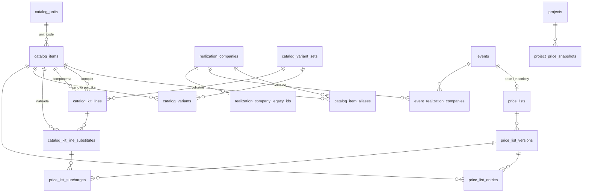

# V1-DATA-01 — Finální datová architektura Generator ABF 1.0

Stav k 2026-10-19, větev `develop`. **Návrh ke schválení, nic z něj není implementováno.** Navazuje na `docs/DEV_DATA_IMPORT_PLAN.md` (rozhodnutí R1–R10) a na schválená pravidla V1.

## 0. Výchozí stav a principy

### Co v kódu a schématu už existuje
| Oblast | Dnes | Mezera vůči V1 |
|---|---|---|
| Katalog | `catalog_items`: `item_type` (PRODUCT, SERVICE, BOOTH, INTERNAL_COMPONENT), `kind`, `abf_code` (unikátní), `internal_code`, `display_name`, `official_name`, `unit` (volný text), `document` jsonb. Mazání karty použité v projektu blokuje trigger | Chybí typ Komplet, číselník jednotek, anglický ABF název ve sloupci a aliasy podle realizaček |
| Komplety | `catalog_item_package_items`: množství, `included_in_package`, poznámka, pořadí; v kódu `domain/catalogPackages.ts` → `pricePackage`. U stánků navíc `BoothType.packageContents` v dokumentu (včetně `print-allowance`) | Chybí náhrady, doplatky, varianty a jednotka řádku. Stejná komponenta nemůže být v kompletu dvakrát |
| Varianty | `BoothType.carpetVariants` / `finishVariants` v jsonb; projekt si ukládá `carpetFinishId` | Chybí vzorník jako data a cena podle skupiny barev |
| Ceníky | `price_lists` (jedna měna, `event_id`, platnost), `pricing_entries` (výběr podle specifičnosti veletrh > realizačka > ceník), navíc ceny v `document.pricingEntries` karet | Chybí verze, kurz, zaokrouhlení, odvozené EUR, typ ceníku (základní/elektřina) a neměnnost |
| Ceny v projektech | **Projekt si ceny neukládá.** `PricingBar` je počítá za běhu ze statických seedů (`data/components.ts`) | Historické ceny zakázek nejsou chráněné |
| Veletrhy | `events` (sloupce a `document`): termíny, uzávěrky, dokumenty, `priceListIds`, `defaultPriceListId`, jedno `realizationCompanyId` | Chybí vazba na základní ceník a ceník elektřiny a více realizaček s rolí |
| Realizační firmy | Dvě sady ID: zástupná `default`, `realization-2..4` (`data/organizations.ts`, `project.realizationProfileId`, klíče `ProductionProfiles` v dokumentech komponent, `price_lists`/`pricing_entries.realization_company_id`) a katalog tiskových ploch `print_surface_realization_companies` (`creativ-expo`, `gendai`, `macik`; FK z `tasks`, `print_surface_projects`, textová vazba z `settlement_*`) | Chybí sjednocení. Import katalogu firem maže a znovu vkládá (viz B1) |
| Aliasy | `catalog_item_names` (ABF originál/alternativa, bez firmy), `settlement_vendor_mappings` (firma + text → karta, se stavem) | Chybí jeden zdroj aliasů pro názvy i kódy |
| Excel | Jen čtení (`lib/import/xlsxReader.server.ts`), jednorázové importy (KODY, tiskové plochy, V6.6) | Chybí export, jednotné šablony a modul Podpora/Návody |

### Principy návrhu
1. **Jen aditivní migrace.** Žádné `drop` sloupců ani tabulek s daty, změnu provází zpětně kompatibilní čtení. Staré struktury se označí jako legacy a přestanou se do nich zapisovat.
2. **Nic se nemaže nenávratně.** Katalog, ceníky, firmy i veletrhy se archivují nebo deaktivují. Publikované cenové verze se nemění.
3. **Stabilní identity.** `catalog_items.id` (uuid) zůstává primární identitou. ABF kód a generátorový kód jsou obchodní klíče, které se smějí změnit, aniž by se rozbily vazby.
4. **Jedna služba pro výpočet cen.** Generátor, katalog pro zákazníka, kalkulace i tiskové plochy budou ceny počítat jedinou funkcí.
5. **Projekt si cenu zafixuje.** Nabídka a objednávka uloží neměnný cenový snapshot.
6. **Do produkce nic, dokud se model neověří v DEV** na vzorové sadě (1 veletrh, 1 ceník, několik položek).

---

## 1. Návrh tabulek a vazeb

### 1.1 Přehled vazeb

`realization_companies` v diagramu znamená stávající tabulku `print_surface_realization_companies`, viz 1.5.

### 1.2 Katalog

**`catalog_items`** (rozšíření stávající tabulky)

| Sloupec | Význam | Změna |
|---|---|---|
| `item_type` | `PRODUCT` (produkty/mobiliář), `SERVICE`, `BOOTH`, `INTERNAL_COMPONENT`, **`KIT`** (komplet) | doplnit hodnotu `KIT` |
| `abf_code` | oficiální ABF kód, unikátní, nepovinný; primární zdroj `KODY.xlsm` | beze změny |
| `internal_code` | **generátorový kód**, unikátní, nepovinný; výchozí hodnota = ABF kód (rozhodnutí A8) | jen přejmenování v UI a dokumentaci |
| `display_name` | **interní (zobrazovaný) název**, česky | beze změny |
| `official_name` | **oficiální název ABF** (CZ) | beze změny |
| `official_name_en` | oficiální název ABF anglicky (dnes v `document.abfImport.abfNameEn`) | nový, doplnit z dokumentu |
| `unit_code` | FK → `catalog_units.code` | nový, vedle volného textu `unit` |
| `lifecycle_status` | draft, needs_review, active, inactive, archived | beze změny; mazání nahrazuje archivace |
| `kind`, `category`, `document` | profil pro generátor, kategorie, geometrie a assety | beze změny |

**`catalog_units`** (nová): `code` PK (`ks`, `m2`, `bm`, `m3`, `den`, `pausal`, …), `name_cs`, `name_en`, `quantity_kind` (count, area, length, volume, time, flat), `aliases text[]` (např. `m²`, `m2/ak`, `ks/d`, které import převede). Řeší R5.

**`catalog_item_aliases`** (nová, jediný zdroj aliasů)

| Sloupec | Význam |
|---|---|
| `id` | uuid |
| `catalog_item_id` | FK → `catalog_items`, `on delete restrict` |
| `realization_company_id` | FK → firmy, **nepovinné**: prázdné = obecný alias, např. ABF alternativní název |
| `alias_kind` | `name` nebo `code` |
| `alias_text`, `normalized_text` | původní a normalizovaný text |
| `unit_code` | jednotka, ve které firma položku účtuje (nepovinné) |
| `source` | manual, import, settlement, abf |
| `status` | suggested, confirmed |
| `active`, `note`, časy | |

Unikátnost: (`realization_company_id`, `alias_kind`, `normalized_text`), pokud je `active`.

- Naplní se z `catalog_item_names` (jako obecné aliasy typu `name`) a z potvrzených řádků `settlement_vendor_mappings`.
- Modul vyúčtování si ponechá vlastní frontu návrhů (`settlement_vendor_mappings` se stavy suggested a unclear). Při potvrzení zapíše alias sem (rozhodnutí A7).

### 1.3 Komplety a varianty

**`catalog_kit_lines`** (vzniká rozšířením `catalog_item_package_items`; tabulka se nepřejmenovává, jde o nové sloupce)

| Sloupec | Význam |
|---|---|
| `package_item_id` | komplet: karta typu `KIT` nebo `BOOTH` (typové stánky E/K a kóje) |
| `child_item_id` | komponenta |
| `line_key` | **nový**, stabilní klíč řádku v kompletu (např. `stena-plna`, `koberec`). Unikátnost se mění z (`package`, `child`) na (`package`, `line_key`), takže stejná komponenta může být v kompletu víckrát |
| `quantity`, `unit_code` | množství a jednotka (`unit_code` nový) |
| `included_in_package` | zahrnuto v ceně kompletu |
| `variant_set_id`, `default_variant_id` | **nové**, řádek s volbou varianty, např. barva koberce |
| `print_allowance` | **nové** jsonb: grafika zahrnutá v kompletu, `{ surfaceIds?: [...], typeIds?: [...], maxAreaM2?, maxRunningM? }` |
| `note`, `sort_order` | beze změny |

Pravidla:
- Komplet nesmí obsahovat sám sebe. Komplet v kompletu je zakázaný, dokud ho výslovně nepovolíme (A14).
- Karta typu `KIT` nemá vlastní geometrii. Typový stánek E/K a kóje zůstávají `BOOTH`, protože mají geometrii, a mají řádky kompletu (A1).

**`catalog_kit_line_substitutes`** (nová): povolené náhrady řádku

| Sloupec | Význam |
|---|---|
| `kit_line_id` | FK → řádek kompletu |
| `substitute_item_id` | FK → `catalog_items` (náhradní komponenta) |
| `substitute_variant_id` | nepovinné, náhrada za jinou variantu, např. jinou barvu |
| `surcharge_rule` | `price_difference`, `fixed`, `per_unit`, `none` |
| `surcharge_unit_code` | pro `per_unit` (např. příplatek za m²) |
| `difference_floor_zero` | u `price_difference`: záporný rozdíl = 0, žádný dobropis (A4) |
| `quantity_factor` | přepočet množství náhrady, výchozí 1 |
| `active`, `sort_order`, `note` | |

Částky doplatků `fixed` a `per_unit` **nejsou v této tabulce**. Patří do ceníku (`price_list_surcharges`), aby se verzovaly a přepočítávaly do EUR stejně jako ostatní ceny. Pravidlo `price_difference` žádnou částku nepotřebuje: počítá se jako cena náhrady minus cena původní komponenty ve stejné cenové verzi a měně.

**`catalog_variant_sets`** (nová, vzorník): `id`, `code` (např. `KOBERCE-2026`), `name`, `kind` (carpet, finish, color), `active`, `valid_from` / `valid_to`, `note`.

**`catalog_variants`** (nová)

| Sloupec | Význam |
|---|---|
| `variant_set_id` | vzorník |
| `code`, `name` | kód podle vzorníku, název barvy |
| `swatch_color`, `texture_asset` | náhled pro generátor a 3D |
| `price_item_id` | FK → `catalog_items`: karta, podle které se varianta účtuje, např. šedý koberec → **M01**, ostatní barvy → **M02** |
| `legacy_finish_id` | ID z `BoothType.carpetVariants`, aby starší projekty s `carpetFinishId` dál fungovaly |
| `active`, `sort_order` | |

Změna barvy koberce v kóji je pak náhrada varianty s pravidlem `price_difference` mezi M02 a M01. Pokud ABF vede na barevný koberec pevný příplatek, použije se `fixed` nebo `per_unit`.

**Grafika zahrnutá v kóji.** Řádek kompletu kóje s komponentou grafiky (např. GRAPHICS-FASCIA) má `included_in_package = true` a vyplněné `print_allowance`. Při generování tiskových ploch se plocha, kterou allowance pokrývá, založí s `includeInCalculation = false` a důvodem `included_in_kit`, a do ceny se znovu nezapočítá. Navazuje to na dnešní `print-allowance` v `BoothType.packageContents` (`domain/technicalServices.ts`), z nějž se data převedou.

### 1.4 Ceníky

**`price_lists`** (rozšíření): hlavička ceníku

| Sloupec | Význam | Změna |
|---|---|---|
| `kind` | `base` (společný základní ceník), `electricity` (výjimky pro elektřinu), `legacy` (dnešní ceník pro jeden veletrh a jednu měnu) | nový; existující řádky = `legacy` |
| `event_id` | `base` = NULL; `electricity` = konkrétní veletrh | beze změny |
| `currency` | jen pro `legacy`; nové ceníky jsou dvouměnové | povinnost se uvolní |
| `code`, `name`, `active` | | beze změny |

**`price_list_versions`** (nová)

| Sloupec | Význam |
|---|---|
| `price_list_id`, `version_no` | unikátní dvojice |
| `status` | `draft` → `published` → `archived` |
| `valid_from`, `valid_to` | platnost; publikované verze jednoho ceníku se nesmějí překrývat |
| `eur_rate` | uložený kurz (CZK za 1 EUR), např. 25,00 |
| `eur_rounding_mode`, `eur_rounding_step` | `round`, `ceil` nebo `floor` a krok (0,01 / 0,5 / 1 / 5) |
| `published_at`, `published_by`, `note` | |

Publikovaná verze je **neměnná**: trigger zakáže změny verze i jejích řádků. Oprava = nová verze.

**`price_list_entries`** (nová)

| Sloupec | Význam |
|---|---|
| `version_id`, `catalog_item_id` | `variant_id` (nepovinné) |
| `price_mode` | `fixed`, `individual` (cena na dotaz), `included` |
| `sale_czk`, `purchase_czk` | CZK ceny |
| `eur_mode` | `derived` (z CZK podle kurzu a zaokrouhlení verze), `fixed` (vlastní pevná EUR cena), `none` (v EUR se neprodává) |
| `sale_eur_fixed`, `purchase_eur_fixed` | jen pro `eur_mode = fixed` |
| `unit_code`, `note` | |

Unikátnost (`version_id`, `catalog_item_id`, `variant_id`). Prázdná buňka v Excelu ≠ 0 (viz oddíl 6).

**`price_list_surcharges`** (nová): částky doplatků za náhrady ve verzi ceníku. `version_id`, `substitute_id` → `catalog_kit_line_substitutes`, `amount_czk`, `eur_mode`, `amount_eur_fixed`.

**View `price_list_entries_resolved`**: vrací výslednou cenu v CZK i EUR (`derived` = zaokrouhlit(`sale_czk` / `eur_rate`), `fixed` = `sale_eur_fixed`), včetně informace o původu ceny.

**Výpočet ceny** (jediná služba `resolvePrice(itemId, variantId?, context)`, kde kontext obsahuje veletrh, datum, měnu a případně připnuté verze z projektu):
1. Služby elektřiny (`item_type = SERVICE` s položkou v ceníku elektřiny veletrhu) se hledají v publikované verzi ceníku `electricity` daného veletrhu platné k datu.
2. Pak v publikované verzi ceníku `base` platné k datu, nebo ve verzi připnuté v projektu.
3. Legacy záloha jen pro projekty bez nového modelu: dnešní `selectPricingEntry` nad `pricing_entries` a `document.pricingEntries`.
4. Když se nic nenajde, služba vrátí stav „cena chybí“ a nikdy nevrátí 0.

**Historické ceny zakázek: `project_price_snapshots`** (nová, neměnná)

| Sloupec | Význam |
|---|---|
| `project_id`, `project_revision` | k jakému stavu projektu snapshot patří |
| `reason` | `offer`, `order`, `invoice`, `manual` |
| `currency`, `eur_rate` | měna a kurz v okamžiku snapshotu |
| `price_list_version_ids` | použité verze (základní a elektřina) |
| `lines` jsonb | položka (id, kódy, názvy v daném okamžiku), množství, jednotka, jednotková cena, režim, původ ceny, řádek kompletu, náhrada, doplatek, zahrnuto, tisková plocha pokrytá kompletem |
| `totals` jsonb | základ, DPH, celkem |
| `created_at`, `created_by` | |

Projekt si navíc v dokumentu ponese `pricingPin: { baseVersionId, electricityVersionId, pinnedAt }`. Po vytvoření nabídky se nové cenové verze projektu automaticky netýkají, dokud je uživatel výslovně nepřecení.

### 1.5 Veletrhy a realizační firmy

**`events`** (rozšíření)

| Sloupec | Význam |
|---|---|
| `base_price_list_id` | FK → `price_lists` (kind `base`) |
| `electricity_price_list_id` | FK → `price_lists` (kind `electricity`, `event_id` = tento veletrh) |
| `default_currency` | dnes jen v dokumentu |
| `start_date`, `end_date` | už existují; provozní údaje (montáž, demontáž, uzávěrky, dokumenty, místo, haly, poznámky) zůstávají v `document` |

`priceListIds` a `defaultPriceListId` v dokumentu zůstávají pro legacy ceníky a nové ceníky je nepoužívají.

**`event_realization_companies`** (nová): `event_id`, `realization_company_id`, `role` (`construction`, `print`, `electricity`, `other`), `is_default`, `note`. Unikátnost (`event_id`, `realization_company_id`, `role`). Nahrazuje jediné `Exhibition.realizationCompanyId`.

**Realizační firmy: sjednocení**
- Kanonickou tabulkou se stane stávající **`print_surface_realization_companies`**, protože na ni už vedou FK z úkolů a projektů tiskových ploch a odkazy z vyúčtování. Fyzicky se nepřejmenuje. V kódu se zavede neutrální název „realizační firmy“ a případně pohled `realization_companies` (A9).
- Rozšíří se o sloupce `short_code`, `legal_name`, `roles text[]`, `contact` jsonb a `sort_order`. `is_active` už existuje.
- **`realization_company_legacy_ids`** (nová): `legacy_id` PK (`default`, `realization-2`, `realization-3`, `realization-4`), `realization_company_id` FK. Projekty, produkční profile v dokumentech komponent a legacy ceníky si ponechají staré ID a převod obstará resolver při čtení (`resolveRealizationCompanyId`). **Dokumenty projektů se nepřepisují.**
- Nové zápisy (veletrhy, aliasy, ceníky) používají už jen kanonická ID.
- Synchronizace katalogu firem a tiskových ploch podle návrhu **B1** (`DEV_DATA_IMPORT_PLAN.md`, oddíl 9): upsert podle ID, chybějící záznamy se jen deaktivují, vše v jedné transakci a s náhledem.

### 1.6 Excel a evidence importů
- `import_batches` (rozšíření): `entity_type` (catalog, kits, prices, events, aliases, kody, print_surfaces), `template_version`, `mode` (dry_run nebo apply), `applied_by`, `summary`.
- `import_rows` (rozšíření): `target_table`, `target_id text` (dnešní `target_entity_id` je jen FK na katalog), `action` (create, update, unchanged, conflict, skipped), `changes` jsonb.

---

## 2. Seznam migrací

Všechny migrace jsou aditivní a do DEV jdou přes `npm run db:dev:check` → `db:dev:apply`. Do produkce zatím nic.

| # | Migrace | Obsah | Závisí na |
|---|---|---|---|
| M1 | `catalog_units` | číselník jednotek a jejich aliasů, seed základních jednotek | — |
| M2 | `catalog_identity` | `item_type` + `KIT`; `official_name_en`, `unit_code`; doplnění z `document.abfImport` a z `unit` přes aliasy jednotek (co nejde převést, zůstane prázdné) | M1 |
| M3 | `realization_companies_unify` | nové sloupce firem; `realization_company_legacy_ids` + seed mapování (A2); pohled `realization_companies` | — |
| M4 | `realization_companies_sync_rpc` | funkce B1 pro synchronizaci firem, typů ploch a rozměrů bez mazání, v transakci | M3 |
| M5 | `catalog_item_aliases` | tabulka + naplnění z `catalog_item_names` a z potvrzených `settlement_vendor_mappings` | M2, M3 |
| M6 | `catalog_variants` | `catalog_variant_sets`, `catalog_variants` (+ `legacy_finish_id`) | M2 |
| M7 | `catalog_kits` | rozšíření `catalog_item_package_items` (`line_key` naplněný z kódu komponenty, `unit_code`, varianty, `print_allowance`), změna unikátnosti, `catalog_kit_line_substitutes`, kontrola zákazu cyklů | M2, M6 |
| M8 | `price_list_versions` | `price_lists.kind`, legacy označení, `price_list_versions`, `price_list_entries`, `price_list_surcharges`, trigger neměnnosti, pohled s výslednou cenou | M7 |
| M9 | `events_pricing_realization` | `events.base_price_list_id`, `electricity_price_list_id`, `default_currency`; `event_realization_companies` (+ převod z `document.realizationCompanyId` přes legacy mapování) | M3, M8 |
| M10 | `project_price_snapshots` | tabulka snapshotů, zákaz změn existujícího snapshotu | M8 |
| M11 | `import_framework` | rozšíření `import_batches` a `import_rows` | — |
| M12 | `excel_apply_rpc` | transakční funkce pro import katalogu, kompletů, cen (vždy do verze `draft`), veletrhů, aliasů; funkce `publish_price_list_version` | M5–M11 |

Mimo databázi: do `projects.document` přibude volitelné `pricingPin` (verze schématu projektu 5 → 6, převod při uložení podle dnešního vzoru).

---

## 3. Dopad na existující API a moduly

| Oblast | Soubory / routy | Dopad |
|---|---|---|
| Administrace katalogu | `app/api/catalog-admin/items/*`, `…/package`, `…/lifecycle`, `AdminPages.tsx` | Nová pole (kódy, názvy, jednotka), editor kompletů s náhradami a variantami, editor aliasů. `package` route se rozšíří, starý tvar zůstane čitelný |
| Import ABF kódů | `app/api/catalog-admin/abf-import`, `domain/catalogAbfImport.ts` | Stane se adaptérem jednotného Excel importu (šablona Katalog, sloupce ABF). Logika párování zůstává |
| Katalog pro generátor | `app/api/catalog/items`, `domain/catalogPricing.ts`, `data/components.ts`, `data/booths.ts` | Generátor bere karty, komplety a varianty z DB. Statické seedy zůstanou jako záloha pro starší projekty |
| Ceny v generátoru | `components/configurator/PricingBar.tsx`, `components/BoothGenerator.tsx` (výběr ceníku nerozlišuje měnu) | Přechod na `resolvePrice` s kontextem veletrhu a měny; rozpad kompletu, náhrady, doplatky; vytvoření snapshotu |
| Administrace cen | `app/api/pricing-admin/*`, `app/api/price-lists/*`, `app/api/pricing/entries`, `PricingAdminPages.tsx`, `domain/pricingAdmin.ts` | Nové verzované endpointy (verze, publikace, řádky, doplatky). Staré endpointy jen čtou legacy ceníky |
| Katalog pro zákazníka | `domain/customerCatalog.ts` (`resolveCatalogPriceList`), PDF katalogu | Ceny z verze základního ceníku, EUR podle kurzu verze |
| Veletrhy | `app/api/events/*`, `domain/organizations.ts`, `domain/eventRepository.ts` | Nová pole v kartě veletrhu, realizačky s rolí. `resolveDefaultPriceList` a `resolveEventPriceListForCurrency` zůstanou pro legacy |
| Technické služby | `domain/technicalServices.ts` | Ceny elektřiny z ceníku elektřiny veletrhu; `print-allowance` převzato z řádků kompletu |
| Tiskové plochy | `app/api/print-surfaces/*`, `PrintSurfaceCatalogImportPanel.tsx`, `domain/printSurfacePricing.ts`, repozitáře `replaceAll` | Synchronizace B1 místo `replaceAll`; plochy pokryté kompletem s `includeInCalculation = false` |
| Kalkulace a exporty | `domain/calculationExport.ts`, `domain/exports.ts` | Čtou ze snapshotu, pokud existuje, jinak z aktuálního výpočtu s označením „nezafixováno“ |
| Vyúčtování | `app/api/settlement-checks/*`, `domain/settlement*.ts` | Potvrzení mapování zapíše alias do `catalog_item_aliases`; porovnání čte aliasy odtud |
| Úkoly | `tasks.realization_company_id` | Beze změny (FK zůstává); B1 odstraní riziko odpojení |
| Importní skripty | `scripts/importBatch*.ts`, `canonicalizeTypeBooths.ts` | Zůstanou jako legacy, nepoužívají se pro nový model; případný import historie se přepíše na šablony (V1-DATA-10) |
| Nový modul | Podpora / Návody | Stránka se šablonami ke stažení a návody; stejné šablony i v administraci |

---

## 4. Kompatibilita s historickými projekty

| Co projekt obsahuje | Riziko | Řešení |
|---|---|---|
| `sceneObjects[].definitionId` (ID ze seedu, uuid karty nebo starší `document.id`), `internalCode` | Karta zmizí nebo změní kód | Karty se nemažou (trigger už existuje, archivace). Identita = uuid nebo starší ID, ne kód. Změna `abf_code` či `internal_code` vazbu nerozbije |
| `boothId`, `variantId`, `carpetFinishId` | Přechod variant do tabulky | `catalog_variants.legacy_finish_id` + resolver; seedy `data/booths.ts` zůstávají jako záloha |
| `realizationProfileId` = `default` / `realization-N`, klíče `ProductionProfiles` | Sjednocení firem | `realization_company_legacy_ids`, převod při čtení, dokumenty se nepřepisují |
| `fairId` | Veletrh se změní | ID veletrhů zůstávají (`beauty`, `decor`, …); veletrh se jen deaktivuje |
| Ceny | **Dnes žádné uložené ceny** | Projekty bez snapshotu: dál se počítají dnešní cestou (legacy) a v UI jsou označené „cena není zafixovaná“. Akce „Zafixovat ceny“ vytvoří první snapshot. Hromadné zpětné fixování produkčních projektů je samostatné rozhodnutí (A10) |
| `printSurfaceAssignments`, projekty tiskových ploch | Odstranění typu plochy nebo firmy | B1: nic se nemaže, jen deaktivuje |
| Legacy ceníky (např. `BEAUTY-2026-CZK`, grafika z migrace 20260825130000) | Nový model ceníků | `kind = legacy`, dál čitelné; nové ceny jen v nových cenících. Převod legacy → base je volitelný import |
| `schema_version` projektu | Nové pole `pricingPin` | Volitelné, převod při uložení (5 → 6), čtení bez něj funguje |

Produkční databáze se při tomto návrhu nemění. Až bude model ověřený v DEV, vznikne samostatný plán nasazení do produkce: migrace jsou aditivní, legacy čtení zůstává a data se doplní až potom.

---

## 5. Doporučené rozdělení implementace

Každý batch má stejný postup: migrace nejdřív jako dry-run v DEV, testy, typecheck, build, bez produkce. Po každém batchi aplikace funguje i se staršími daty.

| Batch | Obsah | Migrace | Výstup k ověření |
|---|---|---|---|
| **V1-DATA-02** Realizační firmy | Sjednocení ID, legacy mapování, synchronizace B1 v administraci tiskových ploch | M3, M4 | Reimport `rozmery_tisk` v DEV bez ztráty vazeb (test s úkolem a projektem) |
| **V1-DATA-03** Identita katalogu | Jednotky, kódy, názvy, aliasy (obecné i podle firem), UI | M1, M2, M5 | Ručně založené vzorové karty s ABF kódem, generátorovým kódem a aliasy Creativ Expo |
| **V1-DATA-04** Komplety a varianty | Řádky kompletu, náhrady, pravidla doplatků, vzorník koberců, `print_allowance`; doménový výpočet (rozšíření `pricePackage`) + testy | M6, M7 | Kóje P86 jako komplet: náhrada koberce (M01 → M02), grafika zahrnutá |
| **V1-DATA-05** Ceníky | Verze, CZK/EUR (kurz, zaokrouhlení, pevné EUR), elektřina podle veletrhu, publikace, `resolvePrice` | M8 | 1 základní ceník + 1 ceník elektřiny, výpočet EUR, neměnnost publikované verze |
| **V1-DATA-06** Karta veletrhu | Přiřazení ceníků, termíny, realizačky s rolí | M9 | FOR BEAUTY podzim 2026 se základním ceníkem a ceníkem elektřiny |
| **V1-DATA-07** Generátor a snapshot | Napojení generátoru, kalkulace a tiskových ploch na `resolvePrice`, rozpad kompletu, snapshot nabídky a objednávky | M10 | Nabídka vzorového projektu; po vydání nové verze ceníku zůstane cena nabídky stejná |
| **V1-DATA-08** Excel a Podpora | Jednotný import/export, šablony, náhled změn, transakční zápis, adaptér KODY, modul Podpora/Návody | M11, M12 | Export → úprava → import bez ztráty hodnot; prázdné buňky nic nemažou |
| **V1-DATA-09** Vzorová sada | Vzorová data v DEV (přes administraci nebo šablony): 1 veletrh, 1 ceník, ~10 položek všech pěti typů, 1 komplet | — | Ověření celého toku v generátoru |
| V1-DATA-10 (později) | Převod historických dat (KODY celý, V6.6, legacy ceníky) do nového modelu přes šablony | — | Až po schválení modelu |

Pořadí 02 → 03 vychází z toho, že aliasy podle firem potřebují kanonické firmy. Batch 05 lze vyvíjet souběžně se 04, ale doplatky (`price_list_surcharges`) potřebují náhrady z 04.

---

## 6. Excel: jednotný import a export

### Šablony (každá se generuje ze stejné definice sloupců jako import i export)
| Sešit | Listy | Identita řádku |
|---|---|---|
| Katalog | `Polozky`, `Komplety` (řádky), `Nahrady`, `Varianty` (vzorníky a barvy) | `id` (exportovaný uuid) → `generator_code` → `abf_code` |
| Ceník | `Verze` (kurz, zaokrouhlení, platnost), `Ceny`, `Doplatky` | (`ceník`, `verze`) + karta + varianta |
| Veletrhy | `Veletrhy`, `Realizacky` | `id` veletrhu |
| Aliasy | `Aliasy` | firma + druh + normalizovaný text |

Každý sešit má skrytý list `_meta` (typ, verze šablony, datum exportu) a první řádek s technickými klíči sloupců. Druhý řádek nese české popisky, aby přejmenování popisku import nerozbilo.

### Pravidla importu
1. **Prázdná nepovinná buňka = beze změny.** Nikdy neblokuje import a nikdy nemaže. Hodnota se maže jen explicitní značkou (A6, návrh `#SMAZAT`).
2. **Řádek, který v souboru chybí, se nemaže.** Deaktivace chybějících záznamů je volitelná, pro každou entitu zvlášť, a v náhledu je ve výchozím stavu vypnutá.
3. **Postup dry-run → náhled → potvrzení → zápis.** Náhled ukáže řádky k vytvoření, aktualizaci, beze změny, konflikty a varování a u aktualizací rozdíl původní a nové hodnoty.
4. **Zápis je transakční** (RPC): buď celý, nebo nic. Každý import se zapíše do `import_batches` a `import_rows`.
5. **Ceny se importují vždy do verze `draft`.** Publikace je samostatný krok s kontrolou překryvu platnosti.
6. **Validace:** kódy (formát, unikátnost, ABF kód ze `KODY`), jednotky přes aliasy z `catalog_units`, existence odkazů (komponenta, firma, veletrh), cykly v kompletech, konzistence EUR režimu.
7. Neznámé sloupce se ignorují s varováním, chybějící nepovinné sloupce nevadí.
8. **`KODY.xlsm`** se načte adaptérem do šablony Katalog. Dnešní párovací pravidla (ABF kód → generátorový kód → název s potvrzením) zůstávají.

### Kde budou šablony
- V administraci: „Stáhnout šablonu“ a „Exportovat aktuální data“ u katalogu, ceníků, veletrhů a aliasů.
- V novém modulu **Podpora / Návody**: prázdné šablony, ukázkový vyplněný soubor a návod ke každé šabloně.

---

## 7. Rizika

| Riziko | Dopad | Opatření |
|---|---|---|
| Souběh legacy a nového cenového modelu | Dvě různé ceny téže položky | Jediná `resolvePrice`; legacy jen jako označená záloha; testy porovnávající oba výsledky na vzorové sadě |
| Projekty nemají uložené ceny | Změna ceníku zpětně změní starou nabídku | Snapshot (M10) dřív, než se v produkci změní jakákoli cena; označení „nezafixováno“ |
| Neměnné verze vs. potřeba opravy | Uživatel nemůže opravit překlep | Rychlé „Vytvořit opravnou verzi“ (kopie verze, úprava, publikace s návazností) |
| Zaokrouhlení EUR | Rozdíl haléřů nebo eur proti ABF | Pravidlo uložené ve verzi; snapshot ukládá výslednou EUR cenu, ne jen vzorec |
| Komplety a náhrady | Složitá pravidla, chyby v doplatcích | Zakázat vnořené komplety (A14), jednotkové testy pravidel, náhled výpočtu v editoru kompletu |
| Sjednocení firem | Špatné mapování `default` → firma změní produkční profily | Mapování schválí uživatel (A2); dokumenty se nepřepisují, takže se mapování dá opravit |
| Round-trip Excelu | Ztráta identity při úpravě kódu v Excelu | Exportovaný `id` jako první klíč; změna kódu = aktualizace, ne nová karta |
| Rozsah | Dlouhá cesta k prvnímu výsledku | Batche 02–07 jsou samostatně ověřitelné; vzorová sada se zakládá postupně |
| Pozdější nasazení do produkce | Velká změna najednou | Aditivní migrace, legacy čtení; produkční plán vznikne až po ověření v DEV |

## 8. Body ke schválení

| # | Rozhodnutí | Návrh |
|---|---|---|
| A1 | Typové stánky E/K a kóje: `BOOTH` s řádky kompletu, nebo samostatný typ `KIT`? | **`BOOTH` s řádky kompletu.** `KIT` jen pro balíčky bez vlastní geometrie |
| A2 | Mapování `default`, `realization-2..4` na skutečné firmy | Potvrdit, např. `default` → `creativ-expo`; ostatní podle skutečného použití v produkčních projektech (zjistit čtením, až to bude povoleno) |
| A3 | Kurz EUR a zaokrouhlení | Kurz ručně ve verzi ceníku; zaokrouhlení nahoru na 1 EUR (potvrdit krok a směr) |
| A4 | Záporný rozdíl cen při náhradě | Nedobropisovat (doplatek 0), pokud to nebude výslovně povoleno u náhrady |
| A5 | Neměnnost publikovaných verzí | Ano; opravy jen novou verzí |
| A6 | Mazání hodnoty přes Excel | Prázdná buňka = beze změny; mazání jen značkou `#SMAZAT` |
| A7 | Aliasy | Jedna tabulka `catalog_item_aliases`; vyúčtování si ponechá frontu návrhů a potvrzení zapisuje alias |
| A8 | Generátorový kód | Výchozí = ABF kód; vlastní kód jen tam, kde ABF kód chybí nebo nestačí (interní komponenty) |
| A9 | Název tabulky firem | Fyzicky zachovat `print_surface_realization_companies` + pohled `realization_companies` |
| A10 | Kdy fixovat ceny projektu | Při vytvoření nabídky a při objednávce; hromadné zafixování starých projektů až v plánu pro produkci |
| A11 | Rozsah výjimek elektřiny | Jen podle veletrhu (ne podle realizačky); položky ceníku elektřiny jen služby typu L |
| A12 | Varianty | Samostatné tabulky vzorníků s `price_item_id` (M01 a M02), ne samostatné karty pro každou barvu |
| A13 | Legacy `pricing_entries` a `document.pricingEntries` | Zmrazit (jen čtení) a nové ceny jen v nových cenících |
| A14 | Komplet v kompletu | Ve v1.0 zakázat |
| A15 | Pořadí batchů | 02 firmy → 03 identita katalogu → 04 komplety → 05 ceníky → 06 veletrh → 07 generátor a snapshot → 08 Excel a Podpora → 09 vzorová sada |
